# SecureChat

Anonymous random text and video chat that runs in the browser. There is no account, no database and no chat history.

It works in two ways, and you can use either:

- **On GitHub Pages (or any static host)**: fully serverless. People find each other and set up calls through a public MQTT broker, so there is nothing to run.
- **With the bundled Node server**: Socket.IO matchmaking and relay, for people who want to host their own.

**Live demo:** https://0x0806.github.io/securechat/

<p align="center">
  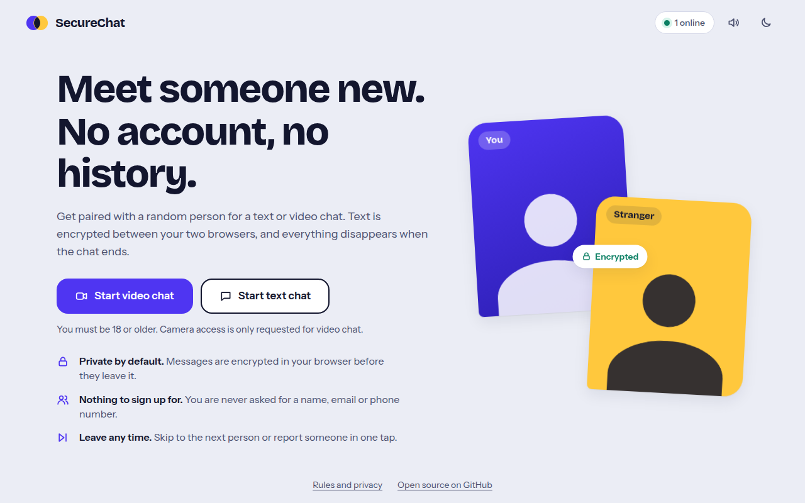
</p>

## Screenshots

These are real captures from the end-to-end test suite (two Chromium browsers talking to each other), not mock-ups.

| Consent gate | Waiting for a match |
|---|---|
| 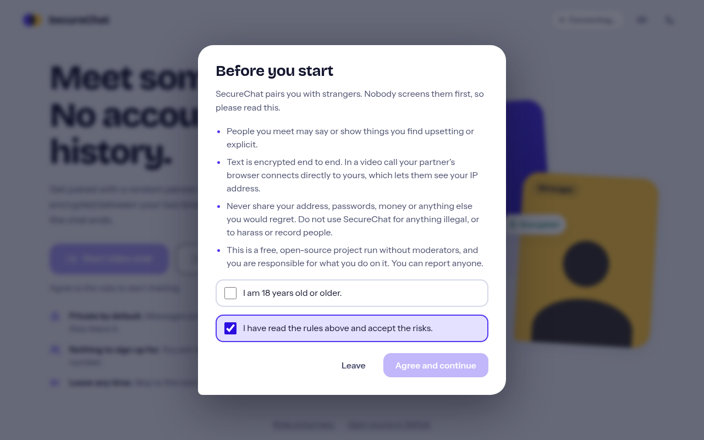 | 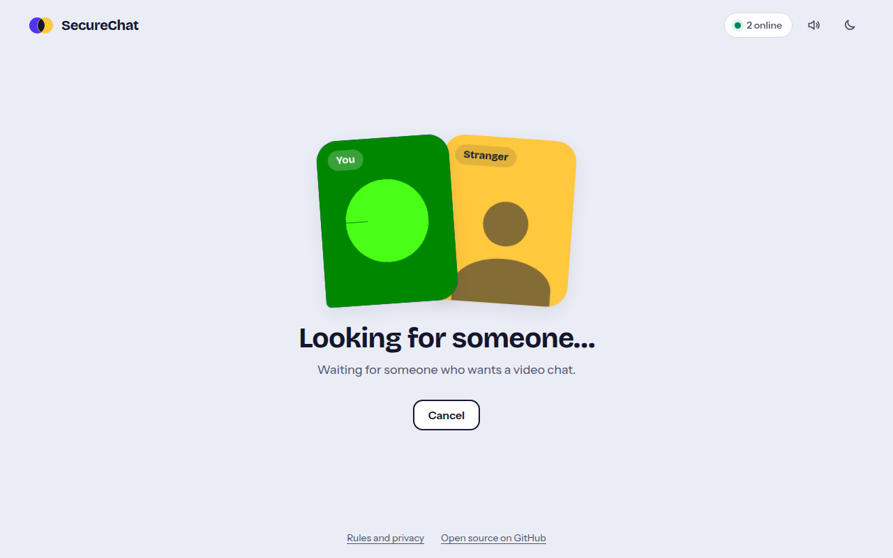 |

| Text chat | Dark theme |
|---|---|
| 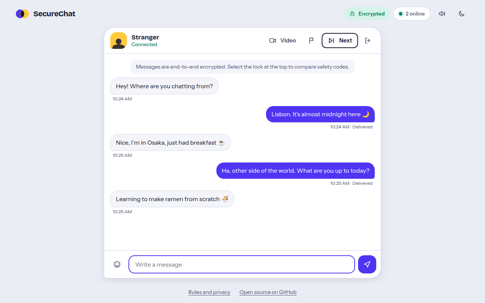 | 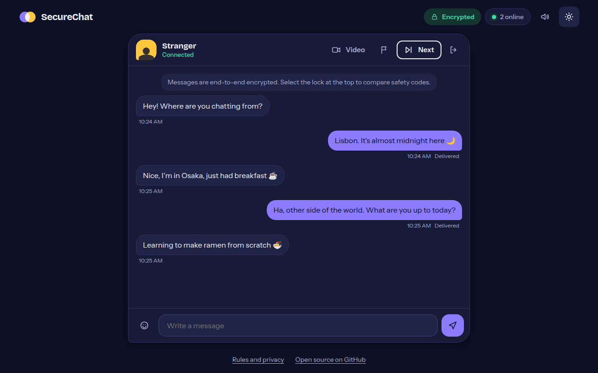 |

| Video call with chat | Safety code |
|---|---|
| 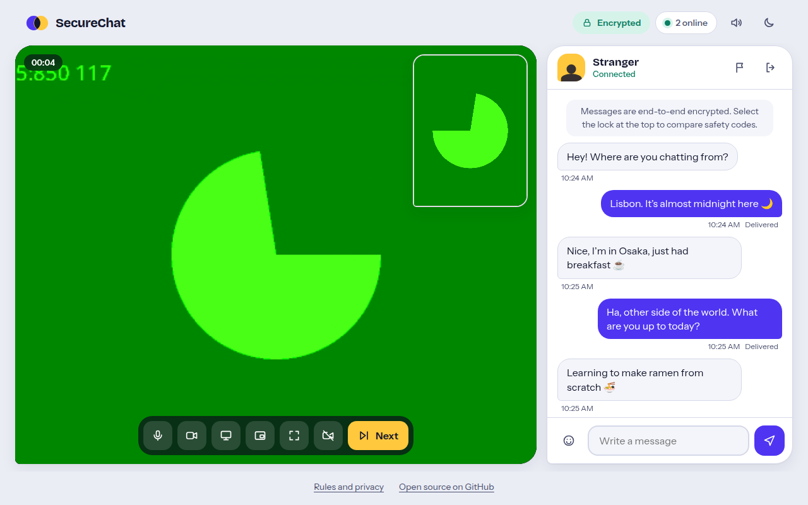 | 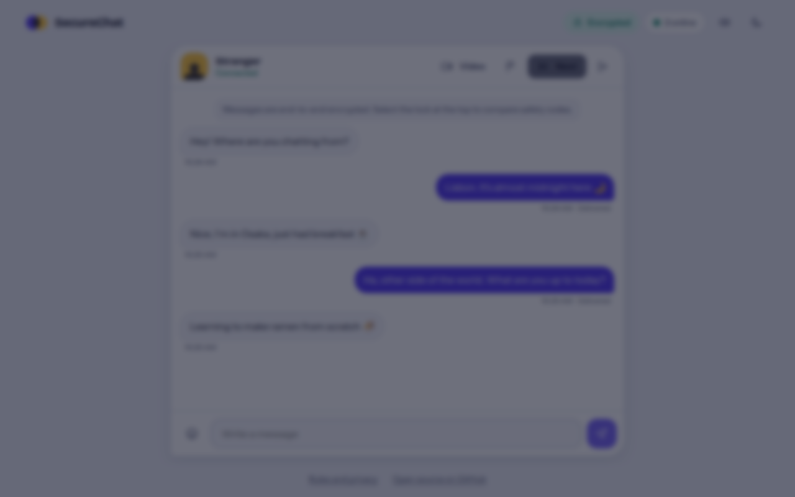 |

| Switch to video request | Mobile |
|---|---|
| 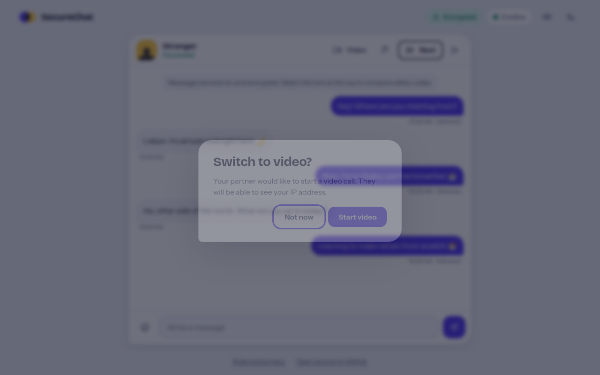 | 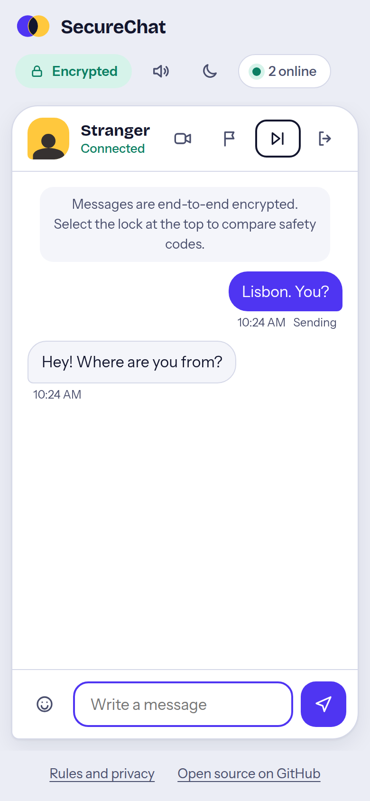 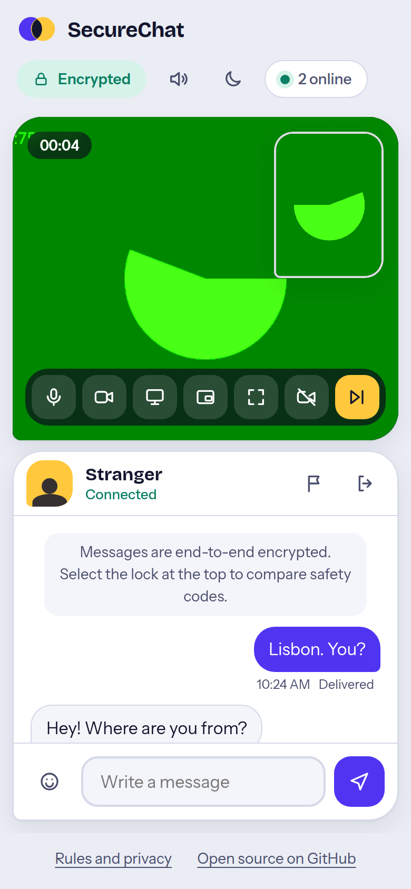 |

## Features

- **Consent first.** A modal dialog explains the risks and needs two ticked boxes (18+, and accepting the rules) before anything works. Esc and clicking outside do not dismiss it. Consent is remembered on your device and can be withdrawn from "Rules and privacy". The Node server also refuses to match anyone who has not consented.
- **Text chat** with typing indicator, emoji picker, delivery status, safe link rendering and a 500-character limit.
- **Video chat** peer to peer over WebRTC, with mute, camera off, camera switch, screen share, pop-out video, full screen, call timer and an in-call text panel.
- **Switch to video** from a text chat. The other person can accept or decline.
- **End-to-end encrypted text.** Browsers agree a key with ECDH (P-256) and encrypt with AES-256-GCM. Sending is disabled until the key exists, so nothing is ever sent in plain text. A safety code lets two people confirm nobody is in the middle.
- **Next, leave and report.** Skip to someone new, leave, or report someone (abuse, nudity, under 18, spam, other).
- **Accessible and responsive.** Keyboard operable, visible focus, screen-reader labels, light and dark themes, reduced-motion support, and layouts for phones through desktop.
- **No third-party assets.** Fonts and icons are bundled. The page runs under a strict Content Security Policy.

Keyboard shortcuts during a chat: `Alt+N` next person, `Alt+M` mute, `Alt+V` camera.

## Deploy on GitHub Pages

1. Fork or push this repo to GitHub.
2. In **Settings → Pages**, set **Source** to **GitHub Actions**.
3. Push to `main`. The workflow in `.github/workflows/pages.yml` publishes the `public/` folder.

Your site is then at `https://<user>.github.io/<repo>/`. Camera access needs HTTPS, which Pages provides.

In this mode the page detects that there is no Node server (`GET health` fails) and switches to serverless mode on its own. You can force it with `?transport=mqtt` or by setting `transport` in `public/config.js`.

### How serverless mode works

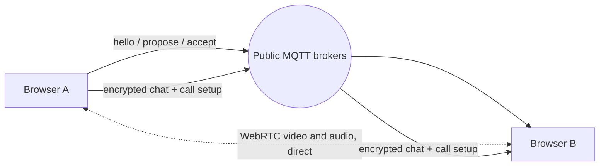

- Everyone waiting for a chat announces themselves on a lobby topic. The peer with the larger random ID proposes, the other accepts, and the pair continues on private per-session topics.
- The app connects to **all** brokers in `config.js` at once, publishes to each, and de-duplicates what it receives, so it keeps working if one broker is down.
- Chat and call-setup messages are acknowledged and re-sent a few times if the acknowledgement does not arrive.
- Video and audio never touch the broker. They flow directly between the two browsers.
- "Online" is an estimate based on recent heartbeats.

## Run it yourself with the Node server

```bash
git clone https://github.com/0x0806/securechat.git
cd securechat
npm install
npm start            # http://localhost:5000 (set PORT to change)
```

Camera access works on `localhost` and on HTTPS sites only.

| Variable | Purpose |
|---|---|
| `PORT` | Port to listen on (default `5000`) |
| `CORS_ORIGIN` | Allowed origin for cross-origin use (default `*`) |
| `STUN_URLS` | Comma-separated STUN URLs to replace the default Google STUN servers |
| `TURN_URL`, `TURN_USERNAME`, `TURN_CREDENTIAL` | Add a TURN relay (see below) |

The server serves the same `public/` folder, keeps matchmaking state in memory only, rate-limits each connection, validates every payload, and exposes `GET /health` and `GET /api/ice-servers`.

## Configuration

`public/config.js`:

```js
window.SECURECHAT_CONFIG = {
  transport: 'auto',                       // 'auto' | 'socket' | 'mqtt'
  namespace: 'securechat-0x0806/v1',       // change this if you fork, so forks do not share a lobby
  brokers: ['wss://broker.hivemq.com:8884/mqtt', 'wss://broker.emqx.io:8084/mqtt'],
  iceServers: [{ urls: ['stun:stun.l.google.com:19302'] }]
};
```

Optional URL parameters: `?ns=my-room` joins a private lobby (share the link with a friend and only people using it can match each other), `?transport=mqtt|socket`, `?cooldown=0` (milliseconds before the same two people can be paired again; default 30000).

**Video behind strict NATs** (some corporate and mobile networks) needs a TURN relay. Add one to `iceServers` in `config.js`, or set `TURN_URL` for the Node server. Without TURN, those users can chat by text but video may fail.

## Security and privacy, honestly

| Question | Answer |
|---|---|
| Is text end-to-end encrypted? | Yes: ECDH P-256 key agreement, AES-256-GCM per message, keys never leave the browser and are discarded when the chat ends. |
| Can the relay read my text? | No. It only carries ciphertext. |
| Can the relay impersonate my partner? | **It could try.** The public keys travel through the relay (the Node server, or the MQTT broker), so a malicious relay could swap them. Compare the **safety code** (lock icon) with your partner to rule this out. |
| Is video encrypted? | Yes, WebRTC uses DTLS-SRTP between the two browsers. |
| Does my partner see my IP address? | **In a video call, yes.** A direct WebRTC connection reveals it. Use a VPN if that matters. |
| What does the server or broker see? | Your IP address (like any web server), connection IDs, who is paired with whom while chatting, and SDP call-setup data. The Node server logs report reasons and connection IDs, and stores nothing else. A public MQTT broker is run by a third party. |
| Are reports reviewed? | The Node server writes them to its log. Serverless mode has no server to receive reports, so a report just moves you on. There are no moderators. |
| Where is my data stored? | Only your consent flag, theme and sound preference are stored in your browser. Messages are never stored. |

Other hardening: strict CSP with no inline script or style, messages are rendered as text (never as HTML), links open with `noopener noreferrer nofollow` and only for `http(s)`, oversized and malformed payloads are dropped, and a stranger's inbound traffic is rate-limited in serverless mode.

This is a hobby-scale project without moderation. Do not rely on it for anything where you need guarantees.

## Tests

```bash
npm test                 # 16 server tests (node:test + socket.io-client), no browser needed
npm run test:e2e         # 32 browser checks across both transports (needs Chromium)
npm run screenshots      # re-captures docs/screenshots
node tests/e2e.js --url=https://0x0806.github.io/securechat/   # test a deployed site
```

The end-to-end suite launches two real Chromium instances with fake camera and microphone devices and walks through consent, matching, encrypted chat in both directions, XSS probes, typing, emoji, upgrade to video (decline and accept), mic and camera controls, reporting, next, leaving, tab close, and video calls that must reach `connected` with video frames flowing. It runs against the Node server and against a static build served like a GitHub project page. Set `CHROMIUM_PATH` if your Chromium is not in a standard location. The serverless run uses a throwaway `?ns=` lobby, so it never touches real users.

## Project layout

```
index.js            Node server (Express + Socket.IO), exported for tests
public/
  index.html        UI, dialogs, icon sprite, CSP
  styles.css        Design system (light + dark)
  app.js            UI, encryption, WebRTC calls
  transport.js      Socket.IO and serverless MQTT transports behind one event contract
  config.js         Runtime configuration
  fonts/, vendor/   Bricolage Grotesque, Instrument Sans, mqtt.js (all bundled)
tests/              server.test.js and e2e.js
docs/screenshots/   README images
.github/workflows/  Pages deploy and CI
```

## Credits and licence

MIT licensed, see [LICENSE](LICENSE). Bundled: [Bricolage Grotesque](https://github.com/ateliertriay/bricolage) and [Instrument Sans](https://github.com/Instrument/instrument-sans) (SIL Open Font License), [MQTT.js](https://github.com/mqttjs/MQTT.js) (MIT).

Built by [0x0806](https://github.com/0x0806).
